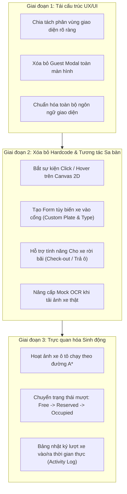

# ĐÁNH GIÁ MÃ NGUỒN, NHẬN XÉT ƯU - KHUYẾT ĐIỂM VÀ KẾ HOẠCH CẢI THIỆN HỆ THỐNG SMARTPARK AI

> **Tài liệu phân tích nội bộ**  
> **Dự án:** SmartPark AI Campus 2026  
> **Mục tiêu:** Mổ xẻ chi tiết các điểm hardcode, bất cập về UX/UI, giải thích vì sao tính năng khó hiểu và vạch rõ lộ trình nâng cấp toàn diện.

---

## 1. TỔNG QUAN HIỆN TRẠNG MÃ NGUỒN & TÍNH NĂNG

Hệ thống hiện tại gồm 2 khối cấu trúc chính:

1. **Khối Điều khiển & Giao diện Cổng vào (`index.html` + `js/main.js`):**
   - Màn hình camera mô phỏng quét biển số xe (Gate OCR) kèm hiệu ứng scanline.
   - Dropdown chọn 8 kịch bản kiểm thử định sẵn (`MOCK_SCENARIOS`).
   - Cờ chuyển đổi chế độ `USE_MOCK` (giả lập độc lập) hoặc Live Server (`http://localhost:8000`).
   - Hộp thoại bật lên (Modal) hỏi đích đến của khách vãng lai khi xe khách vào cổng.
   - Bộ lắng nghe polling 3 giây để cập nhật trạng thái bãi xe khi nối với Backend thật.

2. **Khối Sa bàn Giám sát & Điều phối 2D (`js/canvas.js`):**
   - Vẽ sa bàn 30 ô đỗ xe chia thành 5 phân khu:
     - **Tòa A:** 6 ô (`A-01` .. `A-06`) cạnh Thang máy Tòa A.
     - **Tòa B:** 6 ô (`B-01` .. `B-06`) cạnh Thang máy Tòa B.
     - **Khu xe khách G:** 6 ô (`G-01` .. `G-06`) ở giữa bãi xe.
     - **Tòa C:** 6 ô (`C-01` .. `C-06`) cạnh Thang máy Tòa C.
     - **Tòa D:** 6 ô (`D-01` .. `D-06`) cạnh Thang máy Tòa D.
   - Thang máy cố định (`ELV-A` đến `ELV-D`), 4 cột trụ bê tông và 1 khu vực bảo trì/vật cản.
   - Thuật toán điều phối ô đỗ (`assignOptimalParkingSlot`): Ưu tiên ô gần thang máy của tòa tương ứng; nếu tòa của cư dân đầy thì tự tràn (overflow) sang tòa lân cận gần nhất.
   - Thuật toán A* tìm đường né vật cản từ Cổng `[70, 520]` tới ô đỗ xe và đường đi bộ từ ô đỗ tới sảnh thang máy.

---

## 2. NHẬN XÉT THẲNG THẮN: ƯU ĐIỂM & KHUYẾT ĐIỂM

### 2.1. Ưu điểm (Nền tảng kỹ thuật đã xây dựng được)
- **Thuật toán cốt lõi chính xác:** Logic toán học tìm ô gần thang máy nhất (theo khoảng cách Euclid) và thuật toán tìm đường A* né vật cản (trụ bê tông, khu bảo trì, ô đã có xe) hoạt động ổn định.
- **Cơ chế giữ chỗ (RESERVED) chuẩn nghiệp vụ:** Xe vừa qua cổng sẽ lập tức đổi ô sang màu vàng hổ phách (`isReserved = true`), ngăn chặn việc xe sau vào cổng bị cấp trùng ô.
- **Khung tích hợp API linh hoạt:** Đã chuẩn bị sẵn kiến trúc chuyển đổi mượt mà giữa Mock giả lập và gọi API Backend thật (`/api/gate`, `/api/slots`, `/api/health`).

---

### 2.2. Khuyết điểm lớn (Nguyên nhân gây cảm giác hardcode & khó hiểu)

#### A. Nút bấm bị "đóng băng" (Hardcode) và không có phản hồi tương tác
1. **Nút "📁 Tải ảnh xe" bị lừa dối người dùng:**
   - Trong chế độ Mock, khi người dùng chọn bất kỳ bức ảnh xe nào tải lên, hàm `triggerGateScan(file)` vẫn chỉ đọc dữ liệu cố định trong kịch bản mẫu (`MOCK_SCENARIOS[currentScenarioKey]`) $\to$ Kết quả luôn luôn ra biển số `51A12345` của Tòa A.
   - Điều này khiến tính năng tải ảnh xe trở nên "vô nghĩa", người dùng cảm thấy web bị lỗi hoặc bị lừa dối.
2. **Nút "🚗 Trigger Gate Scan" không cho người dùng tùy biến:**
   - Nút này chỉ kích hoạt lại kịch bản đang chọn trên dropdown. Người dùng không có cách nào tự gõ biển số xe của mình, tự chọn loại xe (Cư dân hay Khách) để thử nghiệm phản xạ của hệ thống.
3. **Bản đồ Canvas hoàn toàn bị "liệt" tương tác (Passive Canvas):**
   - 30 ô đỗ xe trên canvas **không thể click được**. Người dùng không thể click vào một ô để:
     - Chuyển trạng thái giữa Trống (Free) $\leftrightarrow$ Đang đỗ (Occupied).
     - Xem thông tin xe nào đang đỗ tại ô đó.
     - Cho xe rời bãi (Check-out / Trả ô).
   - Vì bản đồ không bấm được, người dùng bị ép buộc 100% phải dùng dropdown 8 kịch bản hardcode để thay đổi trạng thái bãi xe.
4. **Nút "🗺️ Nạp sơ đồ (JSON)" đặt sai vị trí:**
   - Được nhét chung vào cụm nút của camera cổng vào, khiến người xem lúng túng không hiểu đây là thao tác của nhân viên bảo vệ quét xe hay là công cụ của quản trị viên hệ thống.
5. **Tự động kích hoạt khi vừa mở trang (`setTimeout(triggerGateScan, 500)`):**
   - Vừa tải trang 0.5 giây, hệ thống đã tự ý chạy quét một xe cư dân Tòa A mà không cần người dùng thao tác. Người dùng chưa kịp nhìn tổng quan giao diện đã thấy thông tin nhảy loạn xạ.

#### B. Bố trí giao diện (UX/UI Layout) lộn xộn, đa nhân cách
1. **Trộn lẫn 3 vai trò người dùng (User Persona) vào một màn hình:**
   - *Nhân viên bảo vệ trực cổng:* Quan sát camera, nhận diện biển số, mở barrier.
   - *Khách lái xe:* Tự nhiên xuất hiện popup modal to đùng giữa màn hình bắt chọn *"Are you a guest? Select your destination"*.
   - *Ban giám khảo / Developer:* Dropdown chọn kịch bản kiểm thử Mục 9, nút nạp file cấu hình JSON.
   $\to$ Người dùng không biết trang web này đang phục vụ ai, vai trò của mình trong hệ thống là gì.
2. **Modal "Are you a guest?" gây ức chế luồng thao tác:**
   - Khi xe khách vào cổng, một hộp thoại toàn màn hình hiện ra che khuất cả camera và bản đồ. Ngoài thực tế, đây phải là thao tác chọn nhanh trên trụ vé của khách hoặc do bảo vệ bấm chọn điểm đến, chứ không phải một modal chặn trải nghiệm.
3. **Song ngữ tùy tiện (Nửa Anh - Nửa Việt):**
   - Giao diện pha trộn tùy tiện: *"Trigger Gate Scan"*, *"Tải ảnh xe"*, *"A\* Navigation Route"*, *"Assigned Bay (Ô đỗ)"*, *"Are you a guest?"*, *"Cư dân Tòa A"*... Điều này làm mất tính chuyên nghiệp và gây khó hiểu cho cả người dùng Việt lẫn ban giám khảo.
4. **Hành lang giao thông (Aisle) trong A\* bị gán cứng tọa độ pixel:**
   - Hàm `isDrivableAisle` trong `canvas.js` sử dụng các con số pixel cố định (`py >= 135 && py <= 225`, `px >= 415 && px <= 475`). Khi thay đổi kích thước canvas hoặc nạp sơ đồ bãi xe khác từ file JSON, các đường đi này sẽ không còn khớp với các phân khu ô đỗ.

#### C. Thiếu vòng đời của xe (Vehicle Lifecycle)
- Hiện tại hệ thống chỉ có chiều **XE VÀO CỔNG $\to$ CẤP Ô**, hoàn toàn không có chiều ngược lại:
  - Không có hoạt ảnh mô phỏng xe chạy theo đường A\* vào chuồng đỗ.
  - Không có cơ chế **CHO XE RỜI BÃI (Exit / Check-out)** để trả lại ô trống. Sau vài lượt xe vào, bãi đỗ sẽ bị đầy và người dùng bắt buộc phải bấm nút Reset hoặc chọn lại kịch bản.

---

## 3. CÁC ĐIỂM CỐT LÕI CẦN CẢI THIỆN NGAY

| Vấn đề hiện tại | Giải pháp khắc phục triệt để |
| :--- | :--- |
| **Canvas không bấm được** | Bổ sung tương tác chuột: **Click trực tiếp lên từng ô đỗ** để Bật/Tắt trạng thái (Trống $\leftrightarrow$ Có xe), xem chi tiết xe hoặc bấm Trả ô (Exit). |
| **Nút bấm bị khóa cứng vào kịch bản** | Tách bạch 2 chế độ điều khiển:  1. **Mô phỏng tùy biến (Custom Simulator):** Tự gõ biển số bất kỳ, chọn loại xe (Cư dân Tòa A/B/C/D hoặc Khách) $\to$ Cho xe vào cổng. 2. **Kịch bản mẫu (Quick Presets):** Chỉ dùng để nạp nhanh bối cảnh thử nghiệm ban đầu. |
| **Tải ảnh xe không có tác dụng ở Mock mode** | Cho phép nhận diện linh hoạt: Phân tích ảnh tải lên, hiển thị preview và cho phép người dùng xác nhận/chỉnh sửa biển số trước khi cấp ô. |
| **Popup Guest che toàn màn hình** | Bỏ hoàn toàn Modal che màn hình. Chuyển thành **Bảng chọn đích đến nhanh (Quick Destination Buttons)** đặt ngay tại trạm điều khiển cổng. |
| **Bãi xe chỉ có xe vào, không có xe ra** | Bổ sung tính năng **Cho xe rời bãi (Check-out)**: Click vào ô đang đỗ để giải phóng hoặc nhập biển số để mở barrier cho xe ra. |
| **Đường đi A\* nằm bất động** | Thêm **Hoạt ảnh xe di chuyển (Car Animation)** chạy mượt dọc theo đường màu vàng tới ô đỗ, sau đó đổi trạng thái ô từ `RESERVED` sang `OCCUPIED`. |
| **Bố cục màn hình khó hiểu** | Chia lại 3 phân vùng rõ ràng:  1. **Header:** Trạng thái hệ thống, chế độ Mock/Live, sức chứa. 2. **Trạm kiểm soát Cổng (Gate Terminal):** Camera + Điều khiển xe vào/ra. 3. **Sa bàn Giám sát Campus (2D Interactive Twin):** Bản đồ tương tác + Thông tin ô đỗ + Hoạt ảnh xe chạy. |

---

## 4. KẾ HOẠCH NÂNG CẤP CHI TIẾT (ACTION PLAN)

### Giai đoạn 1: Thiết kế lại Layout & Trải nghiệm (UX/UI Refactor) - [COMPLETED]
1. **Tổ chức lại phân vùng màn hình:**
   - **Thanh Header:** Hiển thị tên hệ thống, trạng thái kết nối Backend, thanh tiến trình sức chứa bãi xe (`Available: X/30`).
   - **Cột trái - Trạm kiểm soát Cổng (Gate Terminal):**
     - Màn hình camera quan sát xe ở cổng vào.
     - Bảng điều khiển xe vào: Cho phép chọn nhanh giữa "Xe cư dân" và "Xe khách".
     - Loại bỏ nút "Nạp sơ đồ JSON" khỏi cụm nút này, đưa vào menu cấu hình phụ.
   - **Cột phải - Sa bàn thông minh (Interactive Campus Map):**
     - Bản đồ 30 ô đỗ với chú thích rõ ràng.
     - Thanh công cụ thao tác trên bản đồ (Xóa lộ trình, Đặt lại bãi xe).
2. **Loại bỏ Guest Modal khó chịu:**
   - Khi phát hiện xe khách, hiển thị ngay 4 nút bấm chọn đích đến (`Tòa A`, `Tòa B`, `Tòa C`, `Tòa D`) ngay trong bảng điều khiển dưới camera.
3. **Chuẩn hóa ngôn ngữ:**
   - Chuyển đổi 100% giao diện, nhãn, thông báo và kịch bản sang tiếng Anh chuẩn theo yêu cầu người dùng.

### Giai đoạn 2: Xóa bỏ Hardcode – Biến thành Interactive Smart Twin - [COMPLETED]
1. **Tương tác trực tiếp trên Map Canvas (`js/canvas.js`):**
   - Bắt sự kiện chuột `mousemove` và `click`:
     - **Hover:** Highlight viền ô đỗ phát sáng neon (`#38bdf8`) và đổi con trỏ chuột sang `pointer`.
     - **Click vào ô:** Mở cửa sổ nổi **Bay Inspector Popover** hiển thị mã ô, phân khu, trạng thái, biển số xe.
     - **Click ô trống:** Nút *"🚗 Park Vehicle Here"* $\to$ chuyển thành Occupied ngay trên bản đồ.
     - **Click ô có xe (Occupied/Reserved):** Nút *"🚪 Release Bay (Check-Out)"* $\to$ trả ô về trạng thái Free, cập nhật sức chứa.
     - **Thanh công cụ:** Bổ sung nút *"🧹 Free All"* để nhanh chóng đưa cả 30 ô về trạng thái trống khi kiểm thử.
2. **Bộ điều khiển xe vào cổng linh hoạt (`js/main.js`):**
   - Hỗ trợ 2 tab chuyển đổi: **Custom Vehicle** (Mặc định) và **Preset Demos**.
   - Tab Custom Vehicle:
     - Biển số xe: Tự do nhập biển số bất kỳ + Nút *"🎲 Random"* sinh biển số ngẫu nhiên.
     - Chọn đối tượng: Cư dân Tòa A / B / C / D hoặc Khách vãng lai.
     - Nút *"🚗 Scan Vehicle Entry"*: Hệ thống tính toán ô tối ưu theo đúng hiện trạng bãi xe thực tế tại thời điểm bấm!
3. **Nâng cấp tính năng Tải ảnh xe thật:**
   - Hiển thị ảnh trong camera, tự động trích xuất/gán biển số vào ô nhập, chuyển ngay sang tab Custom để người dùng duyệt và quét xe.
4. **Giữ các kịch bản mẫu làm Quick Presets:**
   - Tab Presets giữ nguyên 8 kịch bản để nạp nhanh bối cảnh khi cần trình diễn các case đặc thù.

### Giai đoạn 3: Trực quan hóa sinh động (Animation & Lifecycle) - [PENDING]
1. **Hoạt ảnh xe ô tô di chuyển (Car Driving Animation):**
   - Khi thuật toán A\* sinh ra đường đi, một biểu tượng xe ô tô nhỏ sẽ chuyển động mượt dọc theo đường màu vàng từ Cổng tới ô đỗ.
   - Khi xe tới nơi, ô đỗ tự động chuyển từ trạng thái `RESERVED` (vàng) sang `OCCUPIED` (đỏ).
2. **Bảng Nhật ký ra/vào (Live Activity Log):**
   - Hiển thị danh sách 5 lượt xe gần nhất: Biển số xe, Loại đối tượng, Ô được cấp, Thời gian vào/ra, Trạng thái.
